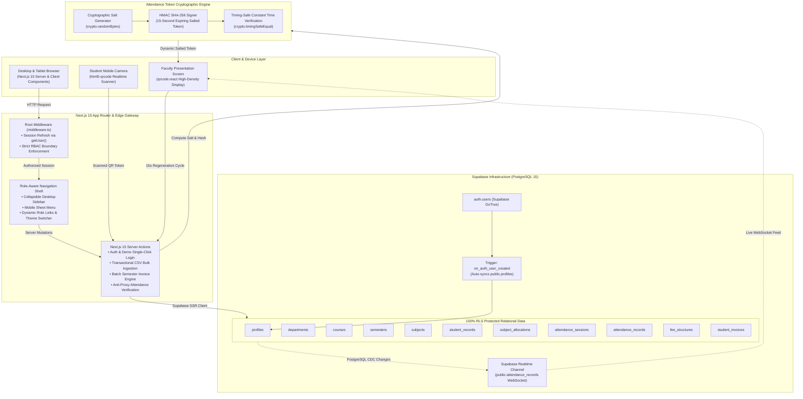

# AcademiaCore CMS — Enterprise College Management System

[](https://nextjs.org/)
[](https://react.dev/)
[](https://www.typescriptlang.org/)
[](https://tailwindcss.com/)
[](https://ui.shadcn.com/)
[](https://supabase.com/)

A modern, production-grade **College Management System (CMS)** engineered for high-density academic governance, anti-proxy cryptographic attendance verification, multi-tenant role-based access control, and automated institutional financial invoicing.

---

## 🏛️ System Architecture



---

## ⚡ Core Engineering Highlights

### 1. Real-Time Anti-Proxy Dynamic QR Attendance Engine
- **Salted 15-Second Expiring Tokens**: Attendance tokens dynamically regenerate every 15 seconds. Each payload incorporates `session_id + timestamp + random_salt` cryptographically signed via **HMAC SHA-256**.
- **Timing-Safe Cryptographic Validation**: Validations reject clock skew ($>15$s window) and execute constant-time comparisons (`crypto.timingSafeEqual`) to prevent timing side-channel attacks.
- **Instant Camera Scanner with Haptic Feedback**: Student scanner built on `html5-qrcode` features camera detection, vibration feedback patterns (`navigator.vibrate`), and verification cards.
- **Supabase Realtime Live Feed**: Live WebSocket channel (`supabase.channel('public:attendance_records')`) pushes attendance confirmations to the faculty classroom screen immediately without page reloads.

### 2. Strict Multi-Tenant RBAC via PostgreSQL Row Level Security (RLS)
- **Zero-Recursion Security Model**: Direct role lookups on `profiles` during RLS evaluations cause circular recursion errors. This system implements isolated `SECURITY DEFINER` functions with fixed `SET search_path = public`:
  - `is_super_admin()`, `is_faculty()`, `is_student()`, and `get_current_student_id()`
- **Defense in Depth**: Access controls operate at the **Middleware Edge Layer**, the **Next.js Server Action Layer**, and the **PostgreSQL Storage Engine**. Students can only inspect their personal enrollment records, attendance marks, and invoices.

### 3. Transactional CSV Student Ingestion & Batch Rollback
- **Client-Side Zod Validation**: The bulk enrollment dropzone validates column headers (`first_name`, `last_name`, `email`, `enrollment_number`, `admission_year`) and verifies row types, email formats, and duplicates prior to transmission.
- **Compensating Transaction Rollback**: Server action tracks all provisioned `student_records`, `profiles`, and `auth.users` IDs. If any row encounters a database collision or syntax error, all previously created records in the batch are rolled back.

### 4. Institutional Finance, Invoicing & A4 Printable Receipt Engine
- **Batch Semester Invoicing**: Administrators define tuition rates, examination fees, and campus development fees by Course and Semester. A 1-click batch engine automatically queries enrolled cohorts and generates `student_invoices` with unique IDs (`INV-2026-XXXX`).
- **Payment Gateway Simulation**: Settles invoices across simulated instruments (Card, Campus NetBanking, Direct UPI), marking balance amounts via PostgreSQL stored generated columns (`amount_due - amount_paid`).
- **Standard A4 Printable Receipts**: Built-in voucher generator formatted for physical printing and PDF export via `@media print` (`@page { size: A4; margin: 10mm; }`), complete with college letterhead, tax registration data, itemized fee tables, and an angled `PAID & SETTLED` watermark.

---

## 🔑 Pre-Configured Demo Personas

The login interface at [`/login`](http://localhost:3000/login) provides **1-Click Demo Quick-Switch Buttons** for immediate evaluation:

| Role | Demo Email | Demo Password | Allowed Routes | Core Features |
| :--- | :--- | :--- | :--- | :--- |
| **Super Admin** | `admin@college.edu` | `AdminDemo123!` | `/admin/*` | Student Directory, Single/Bulk CSV Enrollment, Fee Structure Definition, Batch Invoicing Ledger |
| **Faculty Member** | `faculty@college.edu` | `FacultyDemo123!` | `/faculty/*` | Subject Allocations, Dynamic 15s QR Session Launch, Supabase Realtime Live Check-in Feed |
| **Student** | `student@college.edu` | `StudentDemo123!` | `/student/*` | Student Dashboard, Mobile Camera QR Scanner, Tuition Invoices Ledger, A4 Printable Receipts |

---

## 🚀 Step-by-Step Local Setup

### Prerequisites
- [Node.js 18+](https://nodejs.org/)
- A free [Supabase](https://supabase.com/) project

### 1. Clone & Install Dependencies
```bash
git clone https://github.com/PRINCE5835/COLLEGE-MANAGEMENT-SYSTEM.git
cd COLLEGE-MANAGEMENT-SYSTEM
npm install
```

### 2. Configure Environment Variables
Create a `.env.local` file in the project root:
```bash
cp .env.local.example .env.local
```

Populate the keys from your **Supabase Dashboard &rarr; Project Settings &rarr; API**:
```env
NEXT_PUBLIC_SUPABASE_URL=https://your-project-id.supabase.co
NEXT_PUBLIC_SUPABASE_ANON_KEY=eyJhbGciOiJIUzI1NiIsInR5cCI6IkpXVCJ9...
SUPABASE_SERVICE_ROLE_KEY=eyJhbGciOiJIUzI1NiIsInR5cCI6IkpXVCJ9...
NEXT_PUBLIC_APP_URL=http://localhost:3000
QR_ATTENDANCE_SECRET=your-anti-proxy-hmac-secret-key-32-chars-min
```

### 3. Initialize PostgreSQL Database Schema
1. Open your **Supabase Dashboard &rarr; SQL Editor**.
2. Open [`supabase/schema.sql`](supabase/schema.sql) in this repository.
3. Copy its entire content, paste into the SQL Editor, and click **Run**.
4. All 11 relational tables, custom enum types, automated update triggers, b-tree indexes, and PostgreSQL Row Level Security (RLS) policies will be established.

### 4. Execute the Database Seeder
Seed departments, courses, faculty allocations, 25 students, 30 days of classroom attendance, and tuition invoices:
```bash
npm run db:seed
```

### 5. Launch the Next.js Development Server
```bash
npm run dev
```
Open [http://localhost:3000](http://localhost:3000) in your browser. Use the demo buttons on the login screen to explore the system across Super Admin, Faculty, and Student roles.

---

## 📁 Repository Directory Structure

```plaintext
├── scripts/
│   └── seed.ts                     # Institutional database seeder script
├── src/
│   ├── app/
│   │   ├── (admin)/
│   │   │   ├── dashboard/page.tsx  # Executive metrics & recent admissions
│   │   │   ├── fees/page.tsx       # Fee structure forms & batch invoice generator
│   │   │   └── students/page.tsx   # Student DataTable, Add modal, CSV dropzone
│   │   ├── (auth)/login/page.tsx   # Login page with 1-click demo switcher buttons
│   │   ├── (faculty)/
│   │   │   └── attendance/page.tsx # Live 15s rotating QR code & Realtime attendee feed
│   │   ├── (student)/
│   │   │   ├── fees/page.tsx       # Student fee ledger & payment modal
│   │   │   └── scan/page.tsx       # Mobile-first html5-qrcode camera scanner
│   │   ├── globals.css             # shadcn/ui design tokens & theme tokens
│   │   ├── layout.tsx              # Root HTML & body shell
│   │   └── page.tsx                # Public institutional landing showcase
│   ├── components/
│   │   ├── attendance/             # QR Presenter & Camera Scanner components
│   │   ├── finance/                # AdminFeeManager, PaymentModal & ReceiptModal
│   │   ├── layout/AppShell.tsx     # Responsive role-aware sidebar & navigation
│   │   ├── students/               # StudentDataTable, AddStudentModal & BulkUploadModal
│   │   └── ui/                     # shadcn/ui primitives (Table, Dialog, Button, Badge)
│   ├── lib/
│   │   ├── attendance/crypto.ts    # Salted HMAC SHA-256 dynamic token engine
│   │   └── utils.ts                # Class name merging utility (cn)
│   ├── types/
│   │   └── database.ts             # Strongly typed Supabase database schema
│   └── utils/
│       └── supabase/               # Browser, Server, and Admin Supabase clients
├── supabase/
│   └── schema.sql                  # Complete PostgreSQL DDL schema with RLS & triggers
├── middleware.ts                   # Edge route guard & session cookie refresh
├── tailwind.config.ts              # Tailwind CSS configuration
└── package.json
```

---

## 🔒 Security & Performance Audit

- **Zero Public Writes**: Every table has PostgreSQL Row Level Security enabled (`ALTER TABLE ... ENABLE ROW LEVEL SECURITY`). Write operations are strictly governed by user role checks.
- **Service Role Key Boundary**: `SUPABASE_SERVICE_ROLE_KEY` is exclusively executed in Next.js Server Actions and never bundled into client browser bundles.
- **Cryptographic Anti-Screenshotting**: Classroom check-in QR codes expire every 15 seconds. Forwarding screenshots to absent peers fails the timestamp and cryptographic salt check.
- **Strict Typing**: All PostgREST queries enforce explicit typing against `Database` generic interfaces, maintaining 0 TypeScript compilation errors (`tsc --noEmit`).

---

## 📄 License
Distributed under the **MIT License**. Engineered for modern academic enterprise infrastructure.
